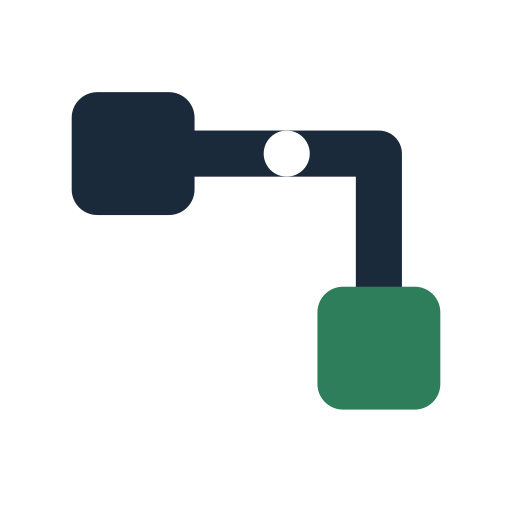

<p align="center">
  <picture>
    <source media="(prefers-color-scheme: dark)" srcset="brand/code-wire-mark-dark.svg">
    
  </picture>
</p>

<h1 align="center">Code-Wire</h1>

**A short text map of the functions a change touches, so agents and reviewers design and check against the map instead of reading the code.**

Status: v3.2. Used on real Python code bases; read *Limits* before adopting.

## What it is

Code-Wire describes a part of a program as black-box functions. Each function gets a typed contract and at least one concrete example taken from its requirement: this goes in, this must come out. The map is a plain text file. A small set of Python tools checks the map against the code and runs the examples.

## What it solves

- **Context.** An agent that designs or reviews a change has to read the code first. The map holds what matters (contracts, callers, examples) in a fraction of the text.
- **Late findings.** Design defects usually show up in code review, after the code is written. A map can be reviewed before any code exists.
- **Unchecked claims.** A design document can say anything. Each example in the map is a value that a run either confirms or refutes.

## How it works

1. **Map.** Write a node for each function the change touches: inputs, output, what it does, and an example from the requirement, not from the code.
2. **Review the map.** Reviewers read the map and the requirements, with no code.
3. **Check against the code.** `codewire_extract.py` compares the map's contracts with the code and lists the real callers of each function, also outside the slice. It exits 1 on any drift.
4. **Prove.** Each example becomes a test. A defect counts only when a test fails before the fix and passes after.

```
write_alarms
req: R-12
in: list[str] alarms; str path = "logs/alarms.txt"
out: int count
func: writes the alarm lines to a file and gives the number of lines
module: logtool/store.py
examples: (T-8) alarms (1 of 1) "A 10:02 disk full" → count `1`
```

## Results

One run per comparison, on one production Python code base (a ~80k-line Textual TUI). Treat them as evidence, not as benchmarks.

**Prototyping a change with the map, against the previous comparable change without it.** Two increments of the same batch, similar scope (10 and 11 low-level requirements, 4 source files each), both run with [dev-flow](https://github.com/<owner>/dev-flow).

| | Without the map | With the map |
|---|---:|---:|
| What design reviewers read | the code: 25 functions, 3,077 lines, in 7 files of 34,677 lines | the map: 237 lines, 6× less text than the functions |
| Major findings caught before code / total | 0 / 8 | 13 / 14 |
| Corrective passes on code | 2 (290 min of agent time) | 1 (54 min) |
| Wall time | 597 min | 267 min* |
| Subagent output tokens | 0.89 M | 1.37 M |

\* Most of the wall-time difference is a full test census that the first increment ran and the second skipped by an operator ruling; it is not due to the map. Total tokens went up: the work moved from fixing code to reviewing the design.

**Auditing existing code, with and without the method.** Two agents on the same slice, once on the clean code and once with 3 seeded defects. Both proved all 3 seeds. The Code-Wire agent proved one more real defect in each run (one of them contestable), at +23% tokens (clean) and +1% (seeded). Its findings came from examples written from the requirement and from the callers list. What found nothing (graph lint, contract rules, a recording checker used as a gate) was removed from the method.

## Install

Python 3.11 or 3.12, standard library only. No package to install.

```sh
git clone https://github.com/<owner>/code-wire.git
cd code-wire
export PYTHONPATH="$PWD/tools"          # PowerShell: $env:PYTHONPATH = "$PWD\tools"
python -m pytest tests                  # optional: the tool tests (needs pytest)
```

## Use

1. Write the map for the functions your change touches. `docs/Metodologia.md` gives the method in seven short sections; `docs/Notation-Grammar.md` gives the exact line format.
2. The prototype is the map only; write nothing in the source. To check the map against the code, let `codewire_marks.py` write the marks `# node: <name>` into a throwaway clone, then run the tools there:

   ```sh
   python tools/codewire_extract.py --repo <your-repo> --graph map.md --path <folder> --out out/
   python tools/codewire_lint.py map.md     # lists lines the parser does not read
   ```

3. Turn each example into a test. Done when every example holds. The extractor report is a list for the person who integrates the change; the next design starts from this graph, so bring it up to date.

To review a whole code base by modules with several agents, see `docs/Review-Method.md` and `tools/codewire_review.py`.

**Best paired with [dev-flow](https://github.com/<owner>/dev-flow).** dev-flow runs the change (requirements, increments, independent review, evidence); Code-Wire is its design prototype, reviewed before any code is written.

## Limits

- The tools read Python only.
- On a small change that one reader can see whole, it costs more than it finds.
- A value that a background worker writes later is not in the recorded values.

## License

Apache License 2.0; see `LICENSE` and `NOTICE`. Developed with AI assistance (Claude) under the author's direction and review.
